# Extraction de locuteur par direction d'arrivée sur signaux ambisoniques


## Sommaire

1. [Résumé des résultats](#1-résumé-des-résultats)
2. [Question de recherche](#2-question-de-recherche)
3. [Principe](#3-principe)
4. [Structure du dépôt](#4-structure-du-dépôt)
5. [Installation](#5-installation)
6. [Données](#6-données)
7. [Protocole expérimental](#7-protocole-expérimental)
8. [Mesures](#8-mesures)
9. [Résultats](#9-résultats)
10. [Discussion](#10-discussion)
11. [Points d'attention](#11-points-dattention)
12. [Limites](#12-limites)
13. [Pistes d'extension](#13-pistes-dextension)
14. [Dépannage (Windows / Spyder)](#14-dépannage-windows--spyder)
15. [Références](#15-références)

---

## 1. Résumé des résultats

Les scènes contiennent deux locuteurs à 0 dB. Les mesures portent sur 200 scènes d'évaluation, les mêmes pour toutes les méthodes. Il n'y a qu'un seul entraînement par configuration.

1. **La conclusion dépend de la statistique choisie.** Le beamformer cardioïde est **excellent sur une minorité de scènes** : sur 28 scènes sur 200, il dépasse 20 dB, et jusqu'à 53 dB. Ce sont les scènes où l'interférent tombe dans son zéro arrière. Sur la moitié des scènes, en revanche, il reste **sous 3,5 dB**. L'autoencodeur est **régulier** : son écart-type est d'environ 3 dB, contre 10,7 dB pour le cardioïde.
   - En **moyenne**, le cardioïde gagne : 8,38 dB contre 7,93 dB pour le modèle sans bruit, à 0° d'erreur.
   - En **médiane**, le modèle gagne nettement : 7,65 dB contre 3,46 dB.
   - Le modèle bat le cardioïde sur **64 à 68 % des scènes**, quel que soit le bruit d'entraînement.
2. **Le bruit d'azimut à l'entraînement fait apparaître le compromis directivité / robustesse.** Plus le bruit est large, plus le modèle tolère l'erreur de visée, et plus il perd à erreur nulle.
   - La tolérance (erreur avant de perdre 3 dB en moyenne, pire des deux côtés) passe de **7,3°** sans bruit à **17,4°** avec N(0, 10²), puis à **plus de 30°** avec U(±30°).
   - En contrepartie, le SI-SDR à 0° baisse de **0,9 dB** avec N(0, 10²) et de **1,45 dB** avec U(±30°).
   - Avec U(±30°), la courbe est presque plate : de 6,3 à 6,5 dB entre −10° et +15°. Sa médiane bat celle des deux beamformers de −30° à +20°.
3. **À variance égale, la forme du bruit (uniforme ou gaussien) ne change rien de mesurable** pour les erreurs positives. C'est l'**amplitude** qui compte. Attention : les modèles comparés n'ont pas tous le même nombre d'époques (§9.4).
4. **Avec une direction de cible fixe et connue**, le modèle `fixed` bat le cardioïde : moyenne de 9,80 dB contre 8,34 dB, médiane de 9,48 dB contre 3,42 dB, et **75 % des scènes gagnées**.
5. **L'hypercardioïde n'est pas une base plus exigeante que le cardioïde.** Son lobe arrière capte les interférents placés derrière. Sa moyenne est plus basse (5,96 dB contre 8,38 dB), mais sa médiane est plus haute (5,72 dB contre 3,46 dB).

---

## 2. Question de recherche

1. Un autoencodeur peut-il apprendre à extraire une voix selon sa direction ? Fait-il mieux qu'un microphone virtuel (beamformer) ?
2. Qu'apporte la **parcimonie** du latent ?
3. Qu'apporte le **conditionnement** par la direction visée (FiLM) ?
4. Le modèle suit-il des **sources mobiles** ?
5. Quelle est sa **tolérance à une erreur de visée** ? Peut-on l'améliorer en injectant du **bruit sur l'azimut pendant l'entraînement** ? Est-ce l'**amplitude** ou la **forme** (uniforme / gaussienne) du bruit qui compte ?

---

## 3. Principe

### 3.1 Modèle physique de la scène

On se place en **champ libre** (pas de salle, donc pas de réverbération) et en **champ lointain** : chaque locuteur est une source ponctuelle assez éloignée pour que son onde arrive sur le microphone comme une **onde plane**. Une onde plane est entièrement décrite par sa direction d'arrivée : l'azimut θ, mesuré dans le plan horizontal, et l'élévation φ.

**Convention d'angle** : θ = 0° correspond à l'avant, θ = +90° à la gauche, et θ croît dans le sens trigonométrique. Ici, toutes les sources sont dans le plan horizontal : φ = 0.

### 3.2 Ambisonie du premier ordre (FOA)

L'ambisonie décompose le champ sonore autour d'un point sur la base des **harmoniques sphériques**. Au premier ordre, on garde 4 composantes, qui correspondent à 4 microphones virtuels placés au même point :

| Canal | Équivalent physique | Directivité | Gain pour une onde venant de (θ, φ) |
|---|---|---|---|
| W | pression (micro omnidirectionnel) | identique dans toutes les directions | $1$ |
| X | gradient de pression avant / arrière (micro en « 8 ») | maximale devant, nulle sur les côtés | $\cos\theta\cos\varphi$ |
| Y | gradient gauche / droite | maximale à gauche, nulle devant | $\sin\theta\cos\varphi$ |
| Z | gradient haut / bas | maximale en haut | $\sin\varphi$ |

Une source $s(t)$ venant de la direction (θ, φ) donne donc le signal à 4 canaux

$$
\mathbf{x}(t) = \mathbf{y}(\theta, \varphi)\, s(t),
\qquad
\mathbf{y}(\theta, \varphi) = \begin{bmatrix} 1 & \cos\theta\cos\varphi & \sin\theta\cos\varphi & \sin\varphi \end{bmatrix}^{\top}.
$$

Le vecteur $\mathbf{y}$ est le **vecteur d'encodage**. La normalisation est **SN3D** : W a un gain de 1, et les canaux du premier ordre ont un gain maximal de 1. Les canaux sont rangés dans l'ordre W, X, Y, Z. Attention : le format AmbiX utilise aussi SN3D, mais range les canaux dans l'ordre W, Y, Z, X.

Comme φ = 0 ici, Z = 0 : ce canal n'apporte aucune information et n'est pas utilisé.

**Scène à deux locuteurs.** La propagation est linéaire, donc les champs s'additionnent. La cible $s_1$ arrive de $\theta_1(t)$ et l'interférent $s_2$ de $\theta_2(t)$ :

$$
\mathbf{x}(t) = \mathbf{y}(\theta_1(t))\, s_1(t) + \mathbf{y}(\theta_2(t))\, s_2(t).
$$

Pour une **source mobile**, $\theta(t)$ varie linéairement pendant le clip, et le gain d'encodage est recalculé à chaque échantillon. Avec un déplacement d'au plus 90° en 2 s, la source tourne d'au plus 1,4° pendant une fenêtre STFT de 32 ms : dans une trame, on peut la considérer comme immobile.

**Écart à la réalité.** Les scènes sont simulées directement au format ambisonique (format B). Un vrai micro ambisonique, avec 4 capsules en tétraèdre, a une directivité qui se dégrade aux hautes fréquences (repliement spatial au-delà de quelques kHz). Il capte aussi la réverbération de la salle. Aucun de ces deux effets n'est simulé ici.

### 3.3 Représentation temps-fréquence (STFT)

Chaque canal $c$ est découpé en trames de $N = 512$ échantillons (32 ms), avec un pas de $H = 128$ échantillons (8 ms, soit 75 % de recouvrement) et une fenêtre de Hann $w$ :

$$
X_c(k, n) = \sum_{t} x_c(t)\, w(t - nH)\, e^{-j 2\pi k t / N},
\qquad k = 0, \dots, 256.
$$

Cela donne $F = 257$ fréquences, espacées de 31,25 Hz, et 251 trames pour un clip de 2 s.

La STFT est linéaire. Dans chaque case $(k, n)$, en considérant les sources immobiles pendant la trame, on a donc :

$$
W = S_1 + S_2,
\qquad
X = \cos\theta_1\, S_1 + \cos\theta_2\, S_2,
\qquad
Y = \sin\theta_1\, S_1 + \sin\theta_2\, S_2.
$$

### 3.4 Descripteurs spatiaux (`features.py`)

**Idée.** En acoustique, la direction d'une onde se lit dans l'**intensité active** : le produit de la pression (canal W) et de la vitesse particulaire (canaux X, Y). On en calcule une version normalisée, dans chaque case temps-fréquence :

$$
i_x(k, n) = \frac{\mathrm{Re}\{W^{*} X\}}{|W|^2 + \epsilon},
\qquad
i_y(k, n) = \frac{\mathrm{Re}\{W^{*} Y\}}{|W|^2 + \epsilon},
\qquad
\ell(k, n) = \log\big(1 + |W|\big).
$$

On ajoute $\epsilon = 10^{-6}$ pour éviter de diviser par zéro.

**Une seule source dans la case.** Avec $W = S$ et $X = \cos\theta\, S$, on obtient $\mathrm{Re}\{W^* X\} = \cos\theta\, |S|^2$, donc :

$$
i_x = \cos\theta, \qquad i_y = \sin\theta.
$$

Le couple $(i_x, i_y)$ est un point du cercle unité qui indique **exactement** la direction de la source, quel que soit son spectre. On pourrait d'ailleurs estimer directement la direction par $\hat\theta = \mathrm{atan2}(i_y, i_x)$. C'est le principe des méthodes classiques de localisation par vecteur d'intensité, comme DirAC.

**Deux sources dans la case.** Avec $c_m = \cos\theta_m$ :

$$
i_x = \frac{c_1 |S_1|^2 + c_2 |S_2|^2 + (c_1 + c_2)\, \mathrm{Re}\{S_1^{*} S_2\}}{|S_1 + S_2|^2}.
$$

- Si **une source domine** la case ($|S_1| \gg |S_2|$), on retrouve la direction de cette source. La parole est **parcimonieuse** en temps-fréquence : à deux locuteurs, la plupart des cases sont dominées par l'un des deux (hypothèse de *W-disjoint orthogonality*). Les descripteurs indiquent donc, case par case, **qui parle**.
- Si les deux sources ont une énergie comparable, on obtient une moyenne pondérée des deux directions, perturbée par le terme croisé $\mathrm{Re}\{S_1^* S_2\}$. Quand $S_1$ et $S_2$ s'annulent partiellement, $|W|^2$ devient petit et $i_x$ peut sortir de $[-1, 1]$. C'est pourquoi les valeurs sont **bornées à $[-2, 2]$**.
- Dans les cases **silencieuses**, $\epsilon$ domine et $i_x, i_y \to 0$ : la case ne porte aucune information de direction.

**Le niveau** $\ell$ indique au modèle quelles cases contiennent de l'énergie. Il lui donne aussi une information spectrale, comme les formants et les harmoniques de la voix.

**Vecteur d'entrée.** Pour chaque trame $n$, on concatène les trois descripteurs sur les 257 fréquences :

$$
\mathbf{f}_n = \big[\, \ell(\cdot, n),\; i_x(\cdot, n),\; i_y(\cdot, n) \,\big] \in \mathbb{R}^{771}.
$$

**Ce que les descripteurs ne contiennent pas** : la phase absolue, le canal Z, et le contexte des trames voisines. Le modèle décide trame par trame.

### 3.5 Modèle (`models.py`)

**Masque.** On cherche un masque réel $M(k, n) \in [0, 1]$ qu'on applique au canal omnidirectionnel :

$$
\hat S_1(k, n) = M(k, n)\, W(k, n),
\qquad
\hat s_1 = \mathrm{iSTFT}\big(\hat S_1\big).
$$

La phase de $\hat S_1$ est celle du mélange $W$.

**Réseau.** Pour chaque trame :

$$
\mathbf{z} = \mathrm{topk}_8\Big(\mathrm{ReLU}\big(A_2\, \mathrm{ReLU}(A_1 \mathbf{f}_n + \mathbf{a}_1) + \mathbf{a}_2\big)\Big) \in \mathbb{R}^{64}_{+}
$$

$$
[\boldsymbol\gamma, \boldsymbol\beta] = g\big(\cos\theta_{\text{visé}}, \sin\theta_{\text{visé}}\big),
\qquad
\mathbf{h} = (1 + \boldsymbol\gamma) \odot \mathbf{z} + \boldsymbol\beta
\quad \text{(FiLM, mode conditionné)}
$$

$$
\mathbf{M}_n = \sigma\big(B_2\, \mathrm{ReLU}(B_1 \mathbf{h} + \mathbf{b}_1) + \mathbf{b}_2\big) \in [0, 1]^{257}
$$

- **Top-k** : on garde les 8 plus grandes valeurs du latent et on met les 56 autres à zéro. Le gradient ne passe que par les 8 dimensions gardées. Chaque trame est donc décrite par peu de « détecteurs » actifs.
- **FiLM** : le petit réseau $g$ (2 → 64 → 128) transforme la direction visée en un gain $\boldsymbol\gamma$ et un décalage $\boldsymbol\beta$ appliqués au latent. Le même encodeur sert pour toutes les directions, et c'est le FiLM qui « oriente » le décodeur. On lui donne $(\cos\theta, \sin\theta)$ plutôt que θ, pour que −180° et +180° donnent la même entrée.
- **Taille** : environ 297 000 paramètres sans conditionnement et 305 000 avec.

**Perte.** C'est une L1 entre la magnitude estimée et la magnitude de la vraie voix, en moyenne sur les cases :

$$
\mathcal{L} = \frac{1}{F N} \sum_{k, n} \Big|\, M(k, n)\, |W(k, n)| - |S_1(k, n)| \,\Big|
\;\; \big(+\, \lambda\, \overline{|\mathbf{z}|} \text{ avec } \texttt{--sparse l1}\big).
$$

Le masque idéal pour cette perte est $M^\star = \min\big(1, |S_1| / |W|\big)$. Quand les deux voix s'annulent partiellement ($|S_1| > |W|$), même le masque idéal ne peut pas reconstruire $|S_1|$. Et comme la phase reste celle du mélange, **la qualité atteignable est plafonnée**. Autre point : la perte porte sur les magnitudes, alors que la métrique finale (SI-SDR) porte sur le signal temporel. Les deux objectifs ne coïncident pas exactement.

### 3.6 Beamformer de référence (`beamformer.py`)

**Micro virtuel.** En combinant les canaux, on fabrique un micro de premier ordre orienté vers $\theta_s$ :

$$
b(t) = p\, W(t) + (1 - p)\big(X(t) \cos\theta_s + Y(t) \sin\theta_s\big).
$$

Pour une onde venant de θ, ce micro a le gain (sa **directivité**) :

$$
G(\Delta) = p + (1 - p) \cos\Delta,
\qquad
\Delta = \theta - \theta_s.
$$

| Directivité | $p$ | Gain sur le côté, $G(90°)$ | Zéros | Gain à l'arrière, $G(180°)$ | Indice de directivité (3D) |
|---|---|---|---|---|---|
| Omnidirectionnel (= W) | 1 | 1 | aucun | 1 | 0 dB |
| **Cardioïde** | 0,5 | 0,5 (−6 dB) | **180°** | **0** | 4,8 dB |
| Supercardioïde | 0,37 | 0,37 (−8,7 dB) | ±125° | −0,27 (−11,4 dB) | 5,7 dB |
| **Hypercardioïde** | 0,25 | 0,25 (−12 dB) | ±109,5° | −0,5 (−6 dB) | 6,0 dB (maximum au 1er ordre) |

**Ce que le beamformer obtient, en théorie.** Prenons une scène immobile, le beamformer visé exactement sur la cible, et deux voix décorrélées de même puissance. La sortie vaut $b = s_1 + G(\Delta)\, s_2$, où Δ est l'écart angulaire entre l'interférent et la cible. Son SI-SDR (§8.1) vaut alors :

$$
\mathrm{SI\text{-}SDR} \approx -20 \log_{10} |G(\Delta)|.
$$

| Interférent à Δ = | 30° | 60° | 90° | 120° | 150° | 180° |
|---|---|---|---|---|---|---|
| Cardioïde | 0,6 dB | 2,5 dB | 6,0 dB | 12,0 dB | 23,4 dB | **∞** |
| Hypercardioïde | 0,8 dB | 4,1 dB | 12,0 dB | 30,1 dB | 13,6 dB | 6,0 dB |

**Conséquences, visibles dans les résultats :**

- **Le cardioïde est « tout ou rien ».** Il est faible tant que l'interférent est à moins de 90° de la cible, et presque parfait quand l'interférent est proche de l'arrière. Avec la distribution d'interférents de ces scènes (§6), la théorie prédit une **médiane de 3,2 dB** et **14 % de scènes au-dessus de 20 dB**. On mesure **3,46 dB et 14 %** (28 scènes sur 200) : c'est ce qui sépare la moyenne de la médiane (§9.1).
- **L'hypercardioïde** rejette mieux les interférents sur les côtés, mais son lobe arrière plafonne le rejet à 6 dB pour un interférent derrière. Médiane prédite : 5,4 dB, mesurée : 5,72 dB.
- **Robustesse à l'erreur de visée.** Avec une erreur $e$, le gain sur la cible devient $G(e)$. Pour le cardioïde, $G(30°) = 0{,}93$, soit seulement −0,6 dB : son lobe est si large qu'une erreur de 30° ne change presque rien. C'est pourquoi le beamformer est presque insensible à l'erreur de visée (§9.2).
- Le beamformer est **fixe** : il ne sait pas où est l'interférent. Un beamformer **adaptatif** (MVDR) placerait son zéro sur l'interférent. Ce serait une base plus exigeante.

### 3.7 Les modes d'entraînement

| Mode | Tâche | Scènes |
|---|---|---|
| `fixed` | Extraire la voix située **devant (0°)**, sans conditionnement | sources immobiles, cible à 0° |
| `conditioned` | Extraire la voix à l'**azimut demandé** (FiLM) | sources mobiles, azimut quelconque |
| `conditioned` + bruit | Idem, avec une consigne volontairement bruitée à l'entraînement | sources mobiles |

### 3.8 Bruit sur l'azimut visé (`sample_az_noise` dans `train.py`)

À l'entraînement, la consigne donnée au FiLM est $\theta_{\text{visé}} = \theta_{\text{vrai}} + \varepsilon$ :

| Type | Tirage | Écart-type de ε | Part des tirages au-delà de 2 écarts-types |
|---|---|---|---|
| uniforme | $\varepsilon \sim \mathcal{U}(-a, +a)$ | $a / \sqrt{3}$ | 0 % (borné à ±a) |
| gaussien | $\varepsilon \sim \mathcal{N}(0, \sigma^2)$ | $\sigma$ | 4,6 % |

Le modèle voit ainsi des consignes imparfaites. Il apprend à garder les cases dont la direction est **proche** de la consigne, et pas seulement **égale** à la consigne : son masque s'élargit en angle.

Le bruit est tiré indépendamment pour chaque échantillon, puis sous-échantillonné à une valeur par trame. Le modèle traite chaque trame séparément, donc ce choix équivaut, en espérance, à un décalage constant par clip. Ce ne serait plus vrai avec un modèle à contexte temporel. Le bruit n'est appliqué **qu'à l'entraînement** : la validation reçoit l'azimut exact.

---
## 4. Structure du dépôt

```
ambisonics.py       encodage FOA (W, X, Y, Z)
scenes.py           scène à deux locuteurs + Dataset généré à la volée
features.py         STFT / iSTFT, descripteurs spatiaux, azimut par trame
beamformer.py       micros virtuels cardioïde et hypercardioïde
models.py           autoencodeur à masque (dense / sparse / FiLM)
metrics.py          SI-SDR
train.py            entraîne les expériences de la liste EXPERIENCES + courbes de perte
evaluate.py         SI-SDR de chaque scène pour chaque .pt de checkpoints/ (option miroir)
plot_results.py     résumé (moyenne, médiane, % gagné, IC), tolérances, asymétrie, figures
analyze_latent.py   carte « dimensions du latent × azimut » pour chaque .pt
config.py           constantes (signal, paramètres des scènes, dossiers de données)
conftest.py         permet à pytest de trouver les modules depuis tests/
tests/              tests unitaires (pytest)
checkpoints/        modèles sauvegardés (.pt)
results/            CSV et figures produits par les scripts
```

---

## 5. Installation

```bash
python -m venv .venv && source .venv/bin/activate     # Windows : .venv\Scripts\activate
pip install -r requirements.txt
pytest
```

### Dossiers de données

Les chemins sont définis dans `config.py`, **relativement au dossier du projet** :

| Constante | Dossier par défaut | Variable d'environnement pour le changer |
|---|---|---|
| `TRAIN_DIR` | `LibriSpeech/` | `AMBI_TRAIN_DIR` |
| `VAL_DIR` | `TRAIN/LibriSpeech/` | `AMBI_VAL_DIR` |
| `TEST_DIR` | `TEST/LibriSpeech/` | `AMBI_TEST_DIR` |

Si `TEST/LibriSpeech/` n'existe pas, `evaluate.py` et `analyze_latent.py` se rabattent sur le dossier de validation et affichent un avertissement.

---

## 6. Données

Il faut un dossier de fichiers audio de parole (`.flac` ou `.wav`, mono). Les scènes sont fabriquées à la volée par `scenes.py` :

- deux locuteurs **différents** (si le dossier suit l'organisation `locuteur/chapitre/fichier` de LibriSpeech) ;
- des clips de 2 s, au même niveau RMS (SIR = 0 dB) ;
- un rééchantillonnage automatique à 16 kHz si besoin ;
- un interférent à `az2 = az1 + U(MIN_SEP_DEG, 360 − MIN_SEP_DEG)`, avec **`MIN_SEP_DEG = −90`** dans `config.py`. C'est la valeur de tous les résultats ci-dessous. Elle ne garantit **aucun écart minimal** entre les deux locuteurs. De plus, l'intervalle couvre 540° : les interférents situés à moins de 90° de la cible sont **deux fois plus probables** que les autres ;
- en mode mobile, chaque locuteur se déplace linéairement d'au plus **90°** pendant le clip (`MAX_MOVE_DEG = 90`).

Pour des scènes avec un écart minimal de 30°, on met `MIN_SEP_DEG = 30`. Il faut alors **tout ré-entraîner et ré-évaluer**.

Il faut des dossiers **séparés** pour l'entraînement, la validation et le test, avec des **locuteurs différents** :

| Usage | Corpus conseillé (Mini LibriSpeech, OpenSLR SLR31) | Taille |
|---|---|---|
| Entraînement | `train-clean-5` | ~332 Mo |
| Validation | `dev-clean-2` | ~126 Mo |
| Test | `test-clean` (SLR12) ou une partie de `dev-clean-2` avec d'autres locuteurs | |

---

## 7. Protocole expérimental

Les valeurs par défaut sont lues dans `config.py`. On peut donc lancer les scripts sans argument, avec le bouton Play de Spyder.

### 7.1 Entraînement

```bash
python train.py                          # toutes les expériences dont le .pt manque
python train.py --only model_cond_gauss10 model_cond_unif30
python train.py --epochs 60              # nombre d'époques
python train.py --seed 1                 # autre graine -> checkpoints suffixés _s1
python train.py --retrain                # ré-entraîne même si le .pt existe
```

`train.py` parcourt la liste `EXPERIENCES` et **ignore les checkpoints déjà présents**. Réglages communs : latent top-k (k = 8 sur 64), taux d'apprentissage 1e-3, 2000 scènes par époque, graine 0.

| Checkpoint | Mode | Bruit d'azimut | Écart-type | Époques (campagne actuelle) | Meilleure val. (L1) |
|---|---|---|---|---|---|
| `model_fixed_none` | `fixed` | – | – | 100 | 0,155 |
| `model_cond_none` | `conditioned` | aucun | 0° | 100 | 0,205 |
| `model_cond_Uniform` | `conditioned` | U(±5°) | 2,9° | 100 | 0,206 |
| `model_cond_gauss2p9` | `conditioned` | N(0, 2,89²) | 2,9° | **60** | 0,212 (ép. 56) |
| `model_cond_gaussian` | `conditioned` | N(0, 5²) | 5° | 100 | 0,209 |
| `model_cond_unif8p7` | `conditioned` | U(±8,66°) | 5° | **60** | 0,215 (ép. 59) |
| `model_cond_gauss10` | `conditioned` | N(0, 10²) | 10° | **60** | 0,227 (ép. 59) |
| `model_cond_unif30` | `conditioned` | U(±30°) | 17,3° | **60** | 0,246 (ép. 57) |

Les paires `Uniform` / `gauss2p9` et `gaussian` / `unif8p7` ont le **même écart-type** : elles servent à isoler l'effet de la forme du bruit.

### 7.2 Évaluation

```bash
python evaluate.py                 # scènes mobiles, erreurs de -30° à +30°
python evaluate.py --mirror        # + chaque scène en miroir gauche / droite (temps x2)
python evaluate.py --static        # modèles conditionnés sur scènes immobiles
```

Tous les `.pt` du dossier `checkpoints/` sont évalués sur les **mêmes scènes** (`--seed 999`). Les modèles `fixed` sont toujours testés sur des scènes immobiles, cible à 0°. Les deux beamformers reçoivent la même direction fautive que le modèle. `evaluate.py` enregistre le SI-SDR **de chaque scène**, puis appelle `plot_results.py`.

Pour refaire le résumé et les figures sans ré-évaluer :

```bash
python plot_results.py --per_scene results/eval_par_scene.csv
```

| Sortie | Contenu |
|---|---|
| `eval_par_scene.csv` | SI-SDR de chaque scène, pour chaque modèle et chaque erreur (+ colonne `mirror`) |
| `eval_comparatif.csv` | par (modèle, erreur) : moyenne, médiane, moyenne plafonnée à 30 dB, % de scènes gagnées contre chaque beamformer, IC 95 % |
| `tolerance.csv` | tolérance `e*`, sur la moyenne et sur la médiane, pour les erreurs positives et négatives |
| `asymetrie.csv` | SI-SDR(−e) − SI-SDR(+e), apparié par scène, avec IC 95 % |
| `robustesse_amplitude.png` | SI-SDR selon l'erreur (moyenne et médiane), pour la série d'amplitudes de bruit |
| `forme_variance_egale.png` | écart apparié gaussien − uniforme à variance égale |
| `compromis.png` | SI-SDR à 0° en fonction de la tolérance |
| `victoires.png` | % de scènes où le modèle bat le cardioïde |
| `distribution_0deg.png` | distribution des SI-SDR par scène à 0° |
| `fixe_vs_beamformer.png` | modèle `fixed` contre cardioïde, sur scènes immobiles |

### 7.3 Analyse du latent

```bash
python analyze_latent.py --n_clips 20 --step 30
```

Pour chaque modèle, le script encode 20 clips **d'une seule source** à chaque azimut, de −180° à +150° par pas de 30°. Il moyenne ensuite le latent **avant FiLM**. Sortie : `results/latent_map_<nom>.png`.

---


## 8. Mesures

### 8.1 SI-SDR (*scale-invariant signal-to-distortion ratio*)

Soient $\hat{\mathbf{s}}$ le signal estimé et $\mathbf{s}$ la vraie voix, tous deux centrés (moyenne retirée). On projette l'estimation sur la référence :

$$
\alpha = \frac{\langle \hat{\mathbf{s}}, \mathbf{s} \rangle}{\|\mathbf{s}\|^2},
\qquad
\mathbf{e}_{\text{cible}} = \alpha\, \mathbf{s},
\qquad
\mathbf{e}_{\text{résidu}} = \hat{\mathbf{s}} - \alpha\, \mathbf{s},
$$

$$
\mathrm{SI\text{-}SDR} = 10 \log_{10} \frac{\|\mathbf{e}_{\text{cible}}\|^2}{\|\mathbf{e}_{\text{résidu}}\|^2} \quad \text{(dB)}.
$$

- **Invariance au gain** : multiplier $\hat{\mathbf{s}}$ par une constante ne change pas le score. On mesure donc la **forme** du signal, pas son volume. C'est indispensable ici, car le beamformer et le masque ne conservent pas le niveau de la cible.
- **Le résidu contient tout ce qui n'est pas la cible** : l'interférent qui reste, les distorsions de la voix dues au masque, les artefacts de phase. Le SI-SDR les pénalise de la même façon, sans les distinguer.
- **Repères** : 0 dB signifie autant d'énergie dans le résidu que dans la cible. Chaque +10 dB divise l'énergie du résidu par 10. Le mélange brut, W = $s_1 + s_2$ avec deux voix de même puissance, est à **0 dB** (mesuré : −0,01 dB).
- **Amélioration** : $\Delta\mathrm{SI\text{-}SDR} = \mathrm{SI\text{-}SDR}(\hat{\mathbf{s}}) - \mathrm{SI\text{-}SDR}(W)$, c'est-à-dire ce qu'apporte la méthode par rapport au mélange brut.
- **Ce qu'il ne mesure pas** : la qualité perçue et l'intelligibilité. Pour cela, il faudrait des mesures perceptives comme PESQ ou STOI (§13).

Dans le code (`metrics.py`), un petit $\epsilon = 10^{-8}$ évite la division par zéro. Une estimation parfaite donne donc une valeur très grande mais finie.

### 8.2 Statistiques sur les scènes

On calcule un SI-SDR $x_i$ par scène $i = 1, \dots, n$ ($n = 200$), pour chaque méthode et chaque erreur de visée.

| Statistique | Définition | Ce qu'elle dit |
|---|---|---|
| Moyenne | $\bar x = \frac{1}{n} \sum_i x_i$ | statistique habituelle, mais très sensible aux scènes extrêmes (cardioïde > 20 dB) |
| Médiane | valeur qui sépare les scènes en deux moitiés | ce qu'obtient une scène typique ; insensible aux scènes extrêmes |
| Moyenne plafonnée | $\frac{1}{n} \sum_i \min(x_i, 30\ \text{dB})$ | moyenne où une scène ne peut pas compter pour plus de 30 dB |
| % de scènes gagnées | $\frac{1}{n} \sum_i \mathbf{1}\big[x_i^{\text{modèle}} > x_i^{\text{beamformer}}\big]$ | sur combien de scènes le modèle fait mieux |

**Pourquoi plusieurs statistiques ?** Les distributions sont très différentes. Le cardioïde est « tout ou rien » (§3.6), avec un écart-type de 10,7 dB. Le modèle est régulier, avec un écart-type d'environ 3 dB. Une seule statistique peut alors donner une conclusion trompeuse : il faut regarder la moyenne **et** la médiane **et** le pourcentage de scènes gagnées.

### 8.3 Intervalles de confiance (bootstrap apparié)

Pour savoir si un écart est réel ou dû au hasard du choix des 200 scènes :

1. On tire 200 scènes **avec remise** parmi les 200, et on calcule la moyenne sur ce tirage.
2. On répète $B = 2000$ fois.
3. L'intervalle de confiance à 95 % va du 2,5ᵉ au 97,5ᵉ centile de ces 2000 moyennes.

Pour comparer deux méthodes A et B, on calcule l'écart **scène par scène**, $d_i = x_i^A - x_i^B$, puis on applique le bootstrap aux $d_i$. Les deux méthodes étant testées sur les mêmes scènes, la difficulté propre à chaque scène s'annule dans l'écart : l'intervalle est beaucoup plus étroit qu'en comparant deux moyennes séparées. **Si l'intervalle ne contient pas 0, l'écart est significatif.**

Ce bootstrap ne mesure que la variabilité due **aux scènes**. La variabilité due **à l'entraînement** (initialisation, ordre des données) demande de répéter avec plusieurs graines.

### 8.4 Tolérance à l'erreur de visée

On note $m(e)$ le SI-SDR (moyen ou médian) quand on vise avec une erreur $e$. La **tolérance** $e^\star$ est la plus grande erreur qui coûte au plus 3 dB :

$$
e^\star = \max\big\{\, e \ge 0 \;:\; m(e) \ge m(0) - 3\ \text{dB} \,\big\},
$$

obtenue par interpolation linéaire entre les erreurs testées. Elle est calculée séparément pour $e > 0$ et $e < 0$. « Pire des deux côtés » désigne la plus petite des deux. Si la courbe ne perd jamais 3 dB dans la plage testée, on note « > 30° ».

### 8.5 Asymétrie

$$
a(e) = \frac{1}{n} \sum_i \big[\, x_i(-e) - x_i(+e) \,\big].
$$

Avec $a(e) < 0$, la méthode fait moins bien quand on vise trop à droite que trop à gauche. Avec `--mirror`, chaque scène est aussi évaluée en miroir gauche / droite ($Y \to -Y$, $\theta \to -\theta$). Le jeu de scènes devient alors parfaitement symétrique : toute asymétrie restante vient du modèle lui-même.

### 8.6 Carte du latent

Pour chaque azimut θ, de −180° à +150° par pas de 30°, on encode 20 clips d'une seule source et on moyenne le latent $\mathbf{z}$, **avant FiLM**, sur les clips et les trames. On obtient une activation moyenne $\bar z_d(\theta)$ pour chaque dimension $d$. La **fraction active** est la part des couples (dimension, azimut) avec $\bar z_d(\theta) > 10^{-6}$. Sur la figure, les dimensions sont triées par azimut préféré. La forme en diagonale vient donc en partie de ce tri : ce qui est informatif, c'est le nombre de dimensions utilisées et la largeur en azimut de chacune.

### 8.7 Courbes d'apprentissage

On trace la perte L1 (§3.5) sur l'entraînement et sur la validation, à chaque époque. Le checkpoint gardé est celui de la **meilleure perte de validation**, calculée avec l'azimut exact.
---

## 9. Résultats

Campagne actuelle : 8 modèles, 200 scènes d'évaluation (graine 999), sources mobiles pour les modèles conditionnés. Fichiers : `results/eval_par_scene.csv`, `eval_comparatif.csv`, `tolerance.csv`, `asymetrie.csv`.

> **Jeu de test** : le cardioïde donne exactement les mêmes valeurs que lors de la campagne précédente. L'évaluation s'est donc très probablement faite sur le dossier de **validation**, faute de dossier `TEST/LibriSpeech/`. Les locuteurs testés sont alors ceux qui ont servi à choisir les checkpoints. Ce biais est léger, et identique pour tous les modèles, mais il reste à corriger.

### 9.1 Moyenne contre médiane : le beamformer est « tout ou rien »

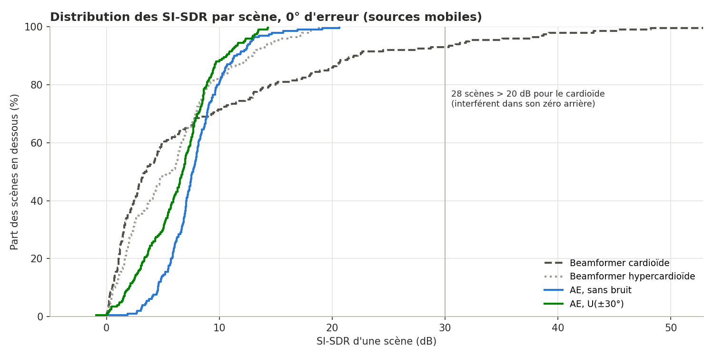

À 0° d'erreur (sources mobiles) :

| Méthode | Moyenne | Médiane | Moyenne plafonnée à 30 dB | Scènes gagnées par le modèle |
|---|---|---|---|---|
| Cardioïde | **8,38** | 3,46 | 7,80 | – |
| Hypercardioïde | 5,96 | 5,72 | 5,96 | – |
| AE sans bruit | 7,93 | 7,65 | 7,93 | 66 % contre le cardioïde, 74 % contre l'hypercardioïde |
| AE U(±5°) | 7,92 | **7,97** | 7,92 | 68 % / 74 % |
| AE N(0, 5²) | 7,82 | 7,77 | 7,82 | 68 % / 74 % |
| AE N(0, 10²) | 7,00 | 7,12 | 7,00 | 65 % / 71 % |
| AE U(±30°) | 6,47 | 6,74 | 6,47 | 64 % / 64 % |

- Le cardioïde a une distribution très étalée : un écart-type de **10,7 dB**, 28 scènes au-dessus de 20 dB et un maximum à 53 dB. Ce sont les scènes où l'interférent passe dans son **zéro arrière**, ce qui donne un rejet presque parfait. Sur la moitié des scènes, il reste **sous 3,5 dB**.
- Le modèle est **régulier** : son écart-type est d'environ 3 dB. Le modèle sans bruit ne dépasse pas 21 dB, et aucun modèle ne dépasse 26 dB. Son masque est plafonné, donc il ne profite jamais de ces cas parfaits, mais il n'a presque pas de scènes ratées.
- **Plafonner à 30 dB ne suffit pas à inverser la moyenne** (7,80 dB pour le cardioïde contre 7,93 dB pour le modèle sans bruit) : beaucoup de scènes du cardioïde se situent entre 20 et 30 dB.
- **La bonne lecture** : le modèle est **meilleur sur deux scènes sur trois**, et le cardioïde l'emporte en moyenne grâce à une minorité de scènes géométriquement favorables. Dans une vraie salle, la réverbération empêcherait ces rejets parfaits à 30 dB ou plus. **Il faut donc rapporter la moyenne ET la médiane.**

### 9.2 Robustesse à l'erreur de visée, selon l'amplitude du bruit

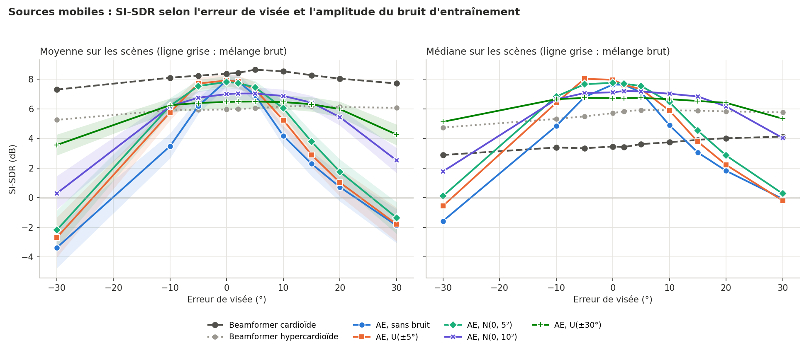

**SI-SDR moyen (dB)**

| Erreur | sans bruit | U(±5°) | N(0, 5²) | N(0, 10²) | U(±30°) | Cardioïde | Hypercardioïde |
|---|---|---|---|---|---|---|---|
| −30° | −3,37 | −2,69 | −2,18 | 0,30 | 3,56 | **7,31** | 5,26 |
| −10° | 3,48 | 5,77 | 6,20 | 6,17 | 6,26 | **8,11** | 5,92 |
| 0° | 7,93 | 7,92 | 7,82 | 7,00 | 6,47 | **8,38** | 5,96 |
| +10° | 4,19 | 5,25 | 6,04 | 6,88 | 6,46 | **8,54** | 6,17 |
| +20° | 0,72 | 1,03 | 1,75 | 5,45 | 5,99 | **8,05** | 6,13 |
| +30° | −1,88 | −1,79 | −1,35 | 2,52 | 4,27 | **7,72** | 6,08 |

**SI-SDR médian (dB)**

| Erreur | sans bruit | U(±5°) | N(0, 5²) | N(0, 10²) | U(±30°) | Cardioïde | Hypercardioïde |
|---|---|---|---|---|---|---|---|
| −30° | −1,58 | −0,56 | 0,11 | 1,78 | **5,13** | 2,89 | 4,74 |
| −10° | 4,84 | 6,41 | **6,84** | 6,64 | 6,66 | 3,40 | 5,32 |
| 0° | 7,65 | **7,97** | 7,77 | 7,12 | 6,74 | 3,46 | 5,72 |
| +10° | 4,90 | 5,90 | 6,46 | **7,03** | 6,66 | 3,75 | 5,90 |
| +20° | 1,82 | 2,22 | 2,86 | 6,17 | **6,41** | 4,02 | 5,83 |
| +30° | −0,08 | −0,19 | 0,28 | 4,04 | 5,34 | 4,13 | **5,77** |

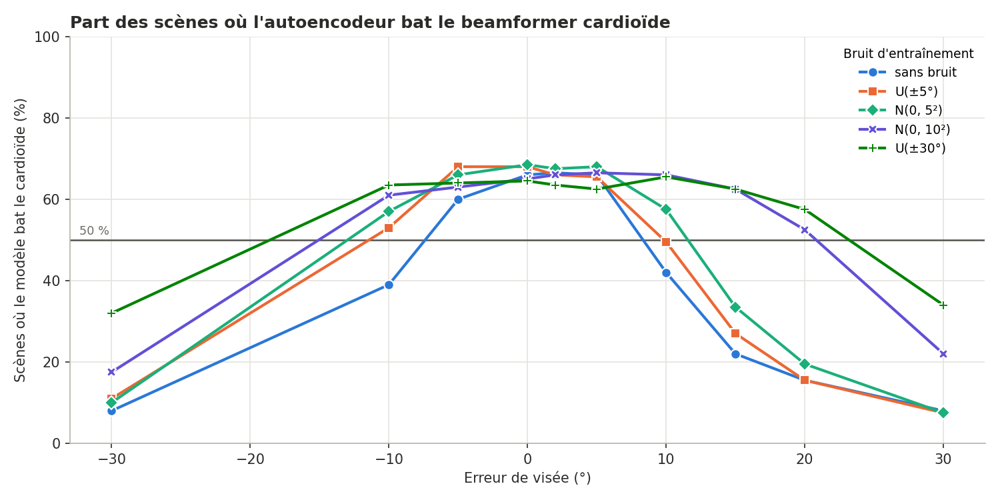

**Part des scènes où le modèle bat le cardioïde (%)**

| Erreur | sans bruit | U(±5°) | N(0, 5²) | N(0, 10²) | U(±30°) |
|---|---|---|---|---|---|
| −30° | 8 | 11 | 10 | 18 | 32 |
| −10° | 39 | 53 | 57 | 61 | 64 |
| 0° | 66 | 68 | 68 | 65 | 64 |
| +10° | 42 | 50 | 57 | 66 | 66 |
| +20° | 16 | 16 | 20 | 52 | 57 |
| +30° | 8 | 8 | 8 | 22 | 34 |

**Écarts appariés par rapport au modèle sans bruit (dB, moyenne [IC 95 %])**

| Erreur | N(0, 10²) − sans bruit | U(±30°) − sans bruit | U(±30°) − N(0, 10²) |
|---|---|---|---|
| −30° | +3,67 [+3,03 ; +4,37] | +6,94 [+6,00 ; +7,97] | +3,27 [+2,62 ; +3,93] |
| 0° | **−0,93** [−1,15 ; −0,73] | **−1,45** [−1,76 ; −1,15] | −0,53 [−0,74 ; −0,33] |
| +10° | +2,69 [+2,18 ; +3,19] | +2,27 [+1,80 ; +2,77] | −0,42 [−0,58 ; −0,25] |
| +20° | +4,73 [+4,06 ; +5,43] | +5,27 [+4,51 ; +6,05] | +0,54 [+0,32 ; +0,78] |
| +30° | +4,40 [+3,70 ; +5,17] | +6,15 [+5,26 ; +7,08] | +1,75 [+1,39 ; +2,12] |

**Lecture**

1. **Sans bruit, le modèle est très directif.** Il perd 3,7 dB en moyenne à +10°, et passe sous le SI-SDR du mélange brut au-delà de 20°.
2. **Un bruit faible (écart-type ≤ 5°) aide peu**, et seulement dans la plage vue à l'entraînement : de +1 à +2 dB autour de 10°, rien au-delà de 20°.
3. **Un bruit large change la forme de la courbe.**
   - Avec N(0, 10²), le modèle reste au-dessus de 6,8 dB de 0° à +10°, et à 5,45 dB à +20°.
   - Avec U(±30°), la courbe est presque plate : de 6,3 à 6,5 dB entre −10° et +15°, puis 6,0 dB à +20°.
4. **Le coût est réel et significatif** : −0,9 dB à 0° pour N(0, 10²) et −1,45 dB pour U(±30°). C'est le compromis attendu (§10).
5. **Contre le cardioïde** :
   - en moyenne, aucun modèle ne le bat, quelle que soit l'erreur ;
   - en médiane et en part de scènes gagnées, les modèles à bruit large (N(0, 10²) et U(±30°)) le battent **de −10° à +20°**. Leur médiane bat aussi l'hypercardioïde dans cette plage.

### 9.3 Le compromis directivité / robustesse

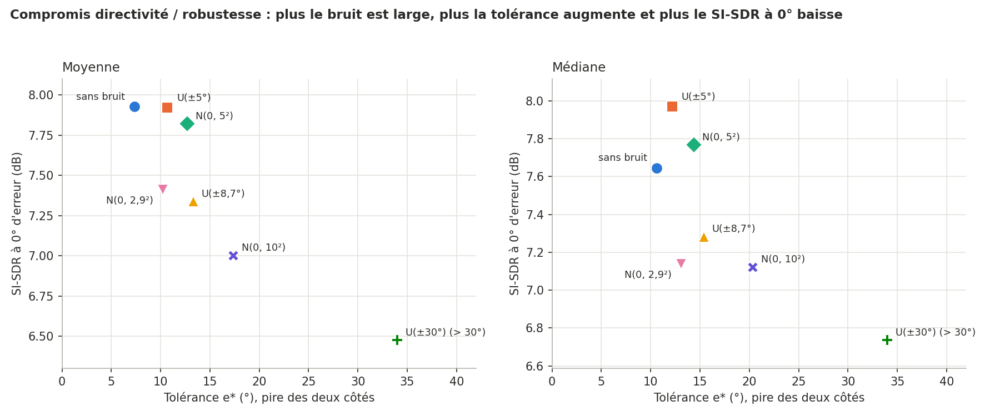

| Modèle | Écart-type du bruit | Moyenne à 0° | Médiane à 0° | `e*` moyenne (+ / −) | `e*` médiane (+ / −) |
|---|---|---|---|---|---|
| sans bruit | 0° | **7,93** | 7,65 | 8,6° / 7,3° | 10,7° / 10,6° |
| U(±5°) | 2,9° | 7,92 | **7,97** | 10,7° / 12,0° | 12,2° / 14,1° |
| N(0, 2,9²)* | 2,9° | 7,41 | 7,14 | 11,8° / 10,2° | 13,7° / 13,1° |
| N(0, 5²) | 5° | 7,82 | 7,77 | 12,7° / 13,3° | 14,4° / 16,2° |
| U(±8,7°)* | 5° | 7,34 | 7,28 | 13,3° / 14,4° | 15,4° / 16,6° |
| N(0, 10²)* | 10° | 7,00 | 7,12 | 24,9° / 17,4° | 29,6° / 20,4° |
| U(±30°)* | 17,3° | 6,47 | 6,74 | **> 30° / > 30°** | **> 30° / > 30°** |

\* 60 époques au lieu de 100 (§9.4).

Les points se rangent le long d'une **frontière** : quand la tolérance augmente, le SI-SDR à 0° diminue. Les modèles à 60 époques sont un peu sous cette frontière, ce qui est cohérent avec un entraînement plus court. **Le choix du bruit d'entraînement revient à choisir un point sur cette frontière**, selon la précision du système de suivi qui fournira l'azimut.

### 9.4 Forme du bruit : uniforme ou gaussien à variance égale

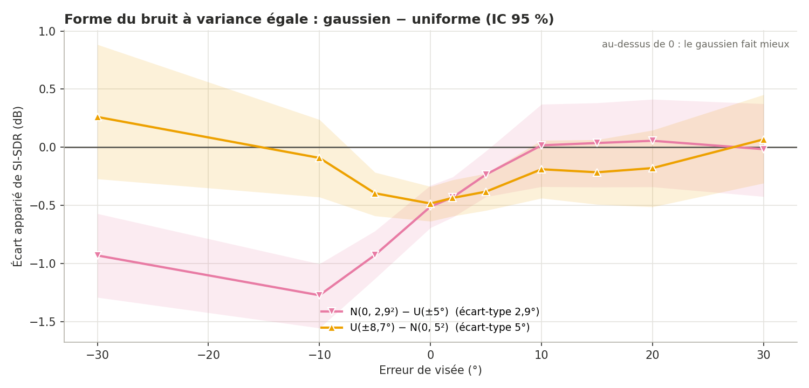

| Erreur | N(0, 2,9²) − U(±5°) | U(±8,7°) − N(0, 5²) |
|---|---|---|
| −30° | −0,93 [−1,29 ; −0,57] | +0,26 [−0,26 ; +0,88] |
| −10° | −1,27 [−1,56 ; −1,00] | −0,09 [−0,41 ; +0,23] |
| −5° | −0,93 [−1,14 ; −0,72] | −0,40 [−0,59 ; −0,19] |
| 0° | −0,51 [−0,69 ; −0,32] | −0,48 [−0,63 ; −0,34] |
| +10° | +0,02 [−0,34 ; +0,39] | −0,19 [−0,44 ; +0,06] |
| +20° | +0,06 [−0,31 ; +0,41] | −0,18 [−0,51 ; +0,15] |
| +30° | −0,02 [−0,41 ; +0,37] | +0,07 [−0,30 ; +0,43] |

**Lecture**

- **Pour les erreurs positives (+10° à +30°), les écarts sont nuls dans la marge d'incertitude**, pour les deux variances.
- **À 0°, les deux modèles récents perdent environ 0,5 dB**, que leur bruit soit gaussien ou uniforme. Ils ont été entraînés sur **60 époques au lieu de 100**. Leur meilleure perte de validation (0,212 et 0,215) correspond à celle des modèles à 100 époques vers l'époque 60. Ce déficit vient donc probablement de l'entraînement plus court, et non de la forme du bruit.
- Le seul écart net est **N(0, 2,9²) sous U(±5°) pour les erreurs négatives**, de −0,9 à −1,3 dB. Il ne se retrouve pas dans l'autre paire et peut venir de l'asymétrie propre à chaque modèle (§9.6).
- **Conclusion : à variance égale, aucun effet de la forme n'est démontré. L'amplitude du bruit, c'est-à-dire son écart-type, explique l'essentiel des différences.** Pour conclure proprement, il faut que tous les modèles aient le même nombre d'époques, puis répéter avec plusieurs graines.

### 9.5 Modèle `fixed` contre beamformer (cible à 0°, sources immobiles)

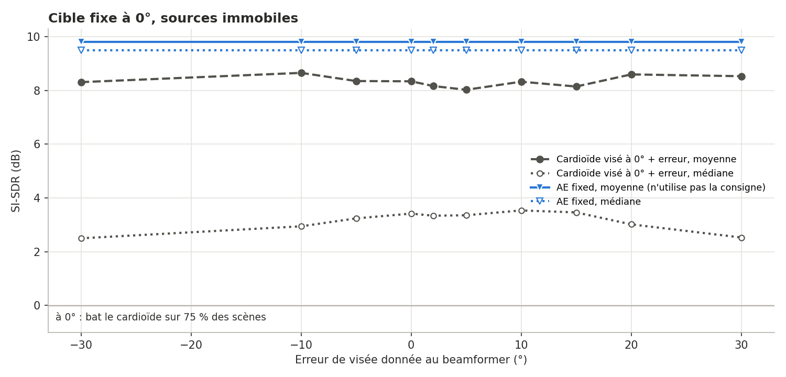

| Méthode | Moyenne | Médiane | Moyenne plafonnée à 30 dB |
|---|---|---|---|
| Cardioïde visé à 0° | 8,34 | 3,42 | 7,23 |
| AE sparse top-k `fixed` | **9,80** | **9,48** | **9,80** |

Le modèle `fixed` gagne sur **toutes** les statistiques, et sur **75 % des scènes**. L'écart moyen est de +1,46 dB [−0,35 ; +3,10]. Son intervalle de confiance touche 0, à cause de la dispersion du cardioïde. Le modèle n'utilise pas de consigne d'azimut : sa courbe plate n'est **pas** une mesure de robustesse.

### 9.6 Asymétrie entre erreurs positives et négatives

`asymetrie.csv`, SI-SDR(−e) − SI-SDR(+e) en dB, sans scènes miroir :

| Modèle | ±5° | ±10° | ±30° |
|---|---|---|---|
| sans bruit | −0,73 [−1,15 ; −0,33] | −0,70 [−1,18 ; −0,21] | −1,50 [−2,51 ; −0,49] |
| U(±5°) | +0,39 [+0,08 ; +0,70] | +0,52 [−0,04 ; +1,10] | −0,90 [−1,96 ; +0,12] |
| N(0, 2,9²) | −0,30 [−0,57 ; −0,01] | −0,77 [−1,25 ; −0,28] | −1,81 [−2,83 ; −0,83] |
| N(0, 10²) | −0,28 [−0,48 ; −0,09] | −0,70 [−1,08 ; −0,34] | −2,23 [−3,33 ; −1,09] |
| U(±30°) | −0,10 [−0,25 ; +0,05] | −0,21 [−0,49 ; +0,08] | −0,71 [−1,61 ; +0,25] |
| Cardioïde | −0,40 [−1,11 ; +0,19] | −0,43 [−1,32 ; +0,37] | −0,41 [−1,92 ; +1,01] |

La plupart des modèles font moins bien aux erreurs négatives, mais pas tous : U(±5°) fait l'inverse à ±5°. Un bug de signe dans le code affecterait tous les modèles de la même façon. Ce n'est pas le cas : il s'agit donc d'un mélange d'effet du jeu de 200 scènes (le cardioïde penche lui aussi du même côté, sans que ce soit significatif) et d'asymétrie apprise par chaque modèle. **À vérifier avec `python evaluate.py --mirror`** : si l'asymétrie disparaît avec les scènes miroir, elle venait des scènes.

### 9.7 Structure du latent

Cartes `results/latent_map_<nom>.png` : 20 clips, une seule source, un azimut tous les 30°, latent **avant FiLM**. Les dimensions sont triées par azimut préféré, donc **la diagonale est en partie produite par le tri**.

| 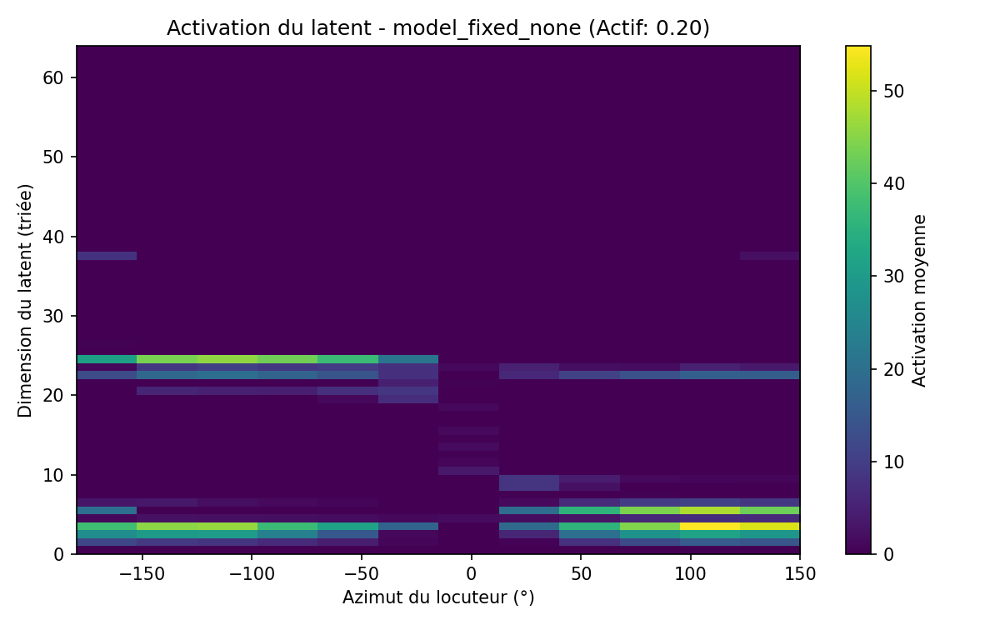 | 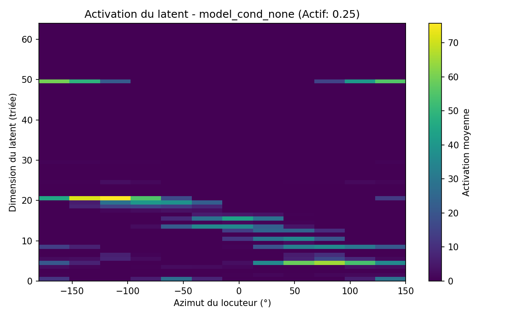 |
|---|---|
| 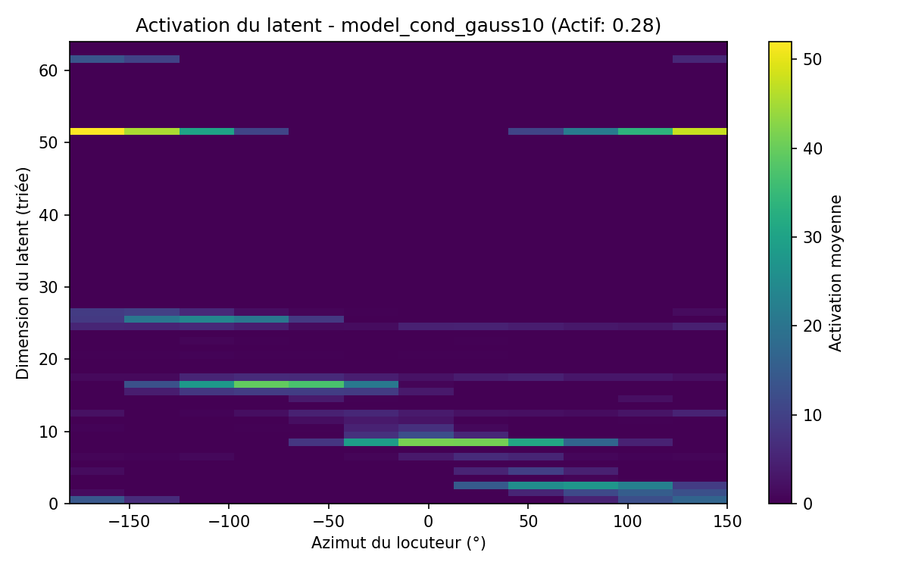 | 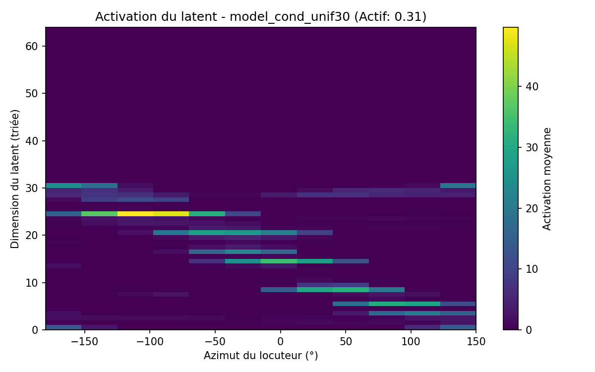 |

| Modèle | Fraction active | Particularités |
|---|---|---|
| `fixed_none` | 0,20 | deux blocs (gauche / droite), **presque rien autour de 0°** |
| `cond_none` | 0,25 | diagonale + raie isolée vers la dimension 50 (arrière, ±150° à 180°) |
| `cond_Uniform` | 0,26 | diagonale, raie vers 26 à l'arrière |
| `cond_gauss2p9` | 0,25 | diagonale + **forte raie vers 38** à l'arrière |
| `cond_gaussian` | 0,26 | diagonale compacte (dimensions 0 à 23) |
| `cond_unif8p7` | 0,24 | diagonale, raies faibles vers 52 et 60 |
| `cond_gauss10` | 0,28 | diagonale + raies vers 52 et 61 à l'arrière |
| `cond_unif30` | **0,31** | activité **étalée sur 0 à 31**, maximum plus faible (≈ 50), pas de raie isolée |

**Observations**

- **Le modèle `fixed` code « ce qui n'est pas devant »**. Quand la source est vers 0°, le latent est presque nul et le décodeur produit un masque par défaut qui laisse passer le signal. Ce modèle n'a pas besoin de coder l'azimut finement, d'où sa fraction active plus faible.
- **Les modèles conditionnés codent l'azimut de façon continue et circulaire** : les mêmes dimensions sont actives à −180° et à +150°.
- **Correction d'une affirmation précédente** : nous avions écrit que le bruit d'azimut faisait disparaître les raies isolées à haut indice. **C'est faux.** `gauss2p9`, `gauss10` et `unif8p7` en ont aussi. Ces raies codent la région arrière et dépendent de l'initialisation.
- **Le seul effet net du bruit sur le latent se voit avec U(±30°)** : plus de dimensions utilisées, une activité plus étalée et moins intense. C'est cohérent avec un modèle qui doit produire des masques plus larges.
- Les fractions actives des modèles déjà analysés ont baissé de 0,02 à 0,03 depuis la campagne précédente, alors que les modèles n'ont pas changé. Les clips d'analyse viennent maintenant du dossier de validation, et non plus de celui d'entraînement. **Des écarts de cet ordre ne sont donc pas interprétables.**

### 9.8 Courbes d'apprentissage

| 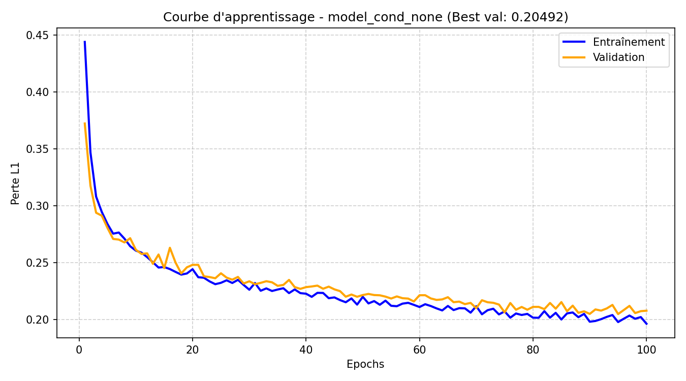 | 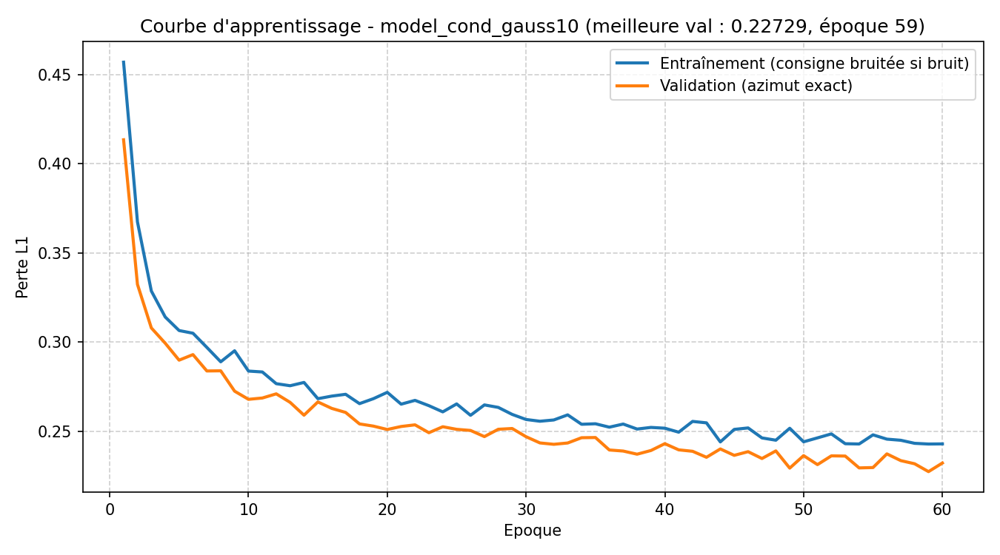 |
|---|---|
| 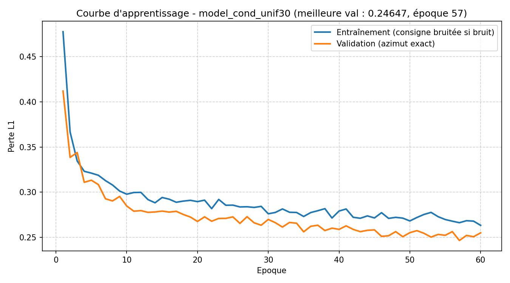 | 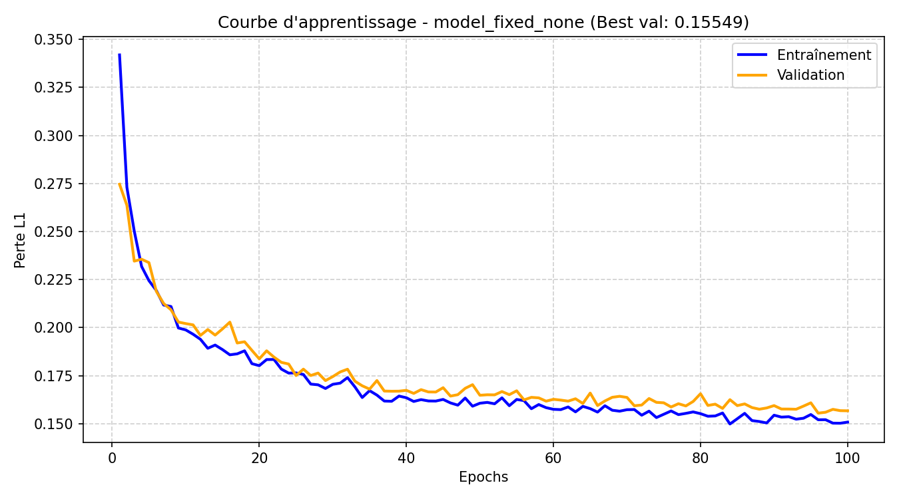 |

- Les modèles à 60 époques atteignent leur meilleure validation aux époques 56 à 59 : ils n'ont **pas fini de converger**.
- Avec un bruit large (`gauss10`, `unif30`), la perte d'entraînement reste **au-dessus** de la validation. C'est normal : l'entraînement se fait avec une consigne fausse, et la validation avec la consigne exacte. Leur perte de validation est plus haute (0,227 et 0,246) : c'est la traduction, sur la perte, du coût de directivité vu à 0°.
- Sans bruit, un léger écart entre entraînement et validation apparaît après environ 60 époques. Le bruit joue aussi un rôle de **régularisation**.

---

## 10. Discussion

**Le modèle et le beamformer n'échouent pas de la même façon.** Le cardioïde dépend de la géométrie : il est presque parfait quand l'interférent est derrière, et médiocre quand l'interférent est à moins de 90° de la cible, ce qui est fréquent dans ces scènes (§6). L'autoencodeur est plafonné par son masque, mais régulier. Selon l'usage :

- si l'on veut le meilleur résultat **en moyenne** sur des scènes simulées sans réverbération, le cardioïde reste devant ;
- si l'on veut **un bon résultat sur la plupart des scènes**, l'autoencodeur est préférable : il gagne sur deux scènes sur trois à consigne exacte.

**Le compromis directivité / robustesse est confirmé, et il est réglable.** L'écart-type du bruit d'entraînement fixe le point sur la frontière (§9.3) :

| Précision du système de suivi | Bruit conseillé | Ce que l'on obtient |
|---|---|---|
| quelques degrés | aucun, ou écart-type ≤ 5° | meilleur SI-SDR à 0° ; s'effondre au-delà de 10° |
| environ 10° | N(0, 10²) | −0,9 dB à 0°, reste au-dessus de 6,8 dB jusqu'à +10° |
| 20° à 30° ou inconnue | U(±30°) | −1,45 dB à 0°, courbe presque plate jusqu'à ±20° |

**La forme du bruit compte peu, son amplitude compte beaucoup.** À variance égale, aucune différence n'est démontrée. Pour choisir un bruit d'entraînement, il suffit donc de viser l'écart-type de l'erreur attendue du système de suivi, voire un peu plus.

**L'hypercardioïde n'est pas une base plus exigeante dans ce cadre.** Son lobe arrière lui coûte cher en moyenne, puisque la moitié des interférents arrivent de l'arrière. Une base vraiment plus forte serait un beamformer **adaptatif** (MVDR), qui place son zéro sur l'interférent.

---

## 11. Points d'attention

| Point | Conséquence | État |
|---|---|---|
| `MIN_SEP_DEG = −90` (`config.py`) | aucun écart minimal entre locuteurs ; interférent deux fois plus probable dans ±90° de la cible | gardé pour la comparabilité ; passer à 30 demande de tout ré-entraîner |
| pas de dossier `TEST/LibriSpeech/` | évaluation probablement sur les locuteurs de validation | **à corriger** : ajouter un jeu de test |
| 4 modèles à 60 époques, 4 à 100 | comparaisons directes biaisées d'environ 0,5 dB à 0° | **à corriger** : ré-entraîner avec le même nombre d'époques |
| une seule graine par configuration | variabilité d'entraînement inconnue | `python train.py --seed 1`, puis `--seed 2` |
| moyenne seule dans les anciennes versions | conclusion biaisée en faveur du cardioïde | **corrigé** : médiane, moyenne plafonnée, % gagné |
| asymétrie ± non expliquée | biais possible du jeu de scènes | **outil ajouté** : `evaluate.py --mirror` |
| chemins Windows absolus, `--moving` impossible à désactiver, `pandas` manquant | – | **corrigés** |

---

## 12. Limites

- Les scènes sont **simulées** : sources ponctuelles, deux locuteurs, élévation nulle, **sans salle**. L'absence de réverbération favorise le beamformer, puisqu'elle permet des rejets parfaits dans son zéro.
- Le modèle travaille trame par trame, sans contexte temporel.
- Le masque réel appliqué sur W avec la phase du mélange plafonne la qualité atteignable.
- Une graine par expérience, 200 scènes d'évaluation, et un nombre d'époques qui n'est pas le même pour tous les modèles.
- L'évaluation porte probablement sur les locuteurs de validation (§9).

---

## 13. Pistes d'extension

**Priorité 1, pour consolider les conclusions :**
- ré-entraîner tous les modèles conditionnés avec le **même nombre d'époques** ;
- ajouter un **jeu de test séparé** ;
- utiliser **3 graines** par configuration ;
- évaluer avec `--mirror`.

**Priorité 2, pour améliorer le modèle :**
- ajouter un contexte temporel (GRU ou convolutions) ;
- estimer un masque complexe ou un filtre multicanal, pour ne plus être plafonné par le masque réel sur W ;
- utiliser une perte directement sur le SI-SDR ;
- appliquer un **curriculum** d'amplitude de bruit.

**Priorité 3, pour des scènes plus réalistes et des bases plus fortes :**
- ajouter de la réverbération (méthode des sources-images) ; on s'attend à ce que l'avantage moyen du cardioïde disparaisse ;
- faire varier les niveaux entre locuteurs ;
- ajouter un bruit de fond ;
- comparer à un beamformer adaptatif MVDR ;
- tester un écart minimal de 30° entre locuteurs.

---

## 14. Dépannage (Windows / Spyder)

| Symptôme | Cause | Solution |
|---|---|---|
| `AssertionError: Aucun fichier .pt trouvé` | dossier `checkpoints/` vide | lancer `train.py` d'abord |
| `AssertionError: Aucun fichier audio dans ...` | dossier de données absent ou mal nommé | vérifier `config.py`, ou définir `AMBI_TRAIN_DIR` / `AMBI_VAL_DIR` |
| `[AVERTISSEMENT] Jeu de test introuvable` | pas de dossier `TEST/LibriSpeech/` | ajouter un jeu de test ou définir `AMBI_TEST_DIR` |
| `train.py` ne fait rien | tous les checkpoints existent | `--retrain`, ou `--only <nom>` |
| `PermissionError: ... results/*.csv` | fichier ouvert dans Excel | fermer le fichier, relancer |
| `OMP: Error #15 ... libiomp5md.dll`, puis le kernel s'arrête | deux copies d'OpenMP | `os.environ["KMP_DUPLICATE_LIB_OK"] = "TRUE"` avant l'import de `torch` (déjà en place) |
| entraînement lent | lecture et décodage des `.flac` à chaque scène | mettre `load_audio` en cache (`functools.lru_cache`), préparer la validation une seule fois |

---

## 15. Références

- Marković et al. — filtrage spatial implicite pour la séparation multicanale.
- Paek et al. — autoencodeurs sparse dans les espaces latents audio.
- Perez et al., *FiLM: Visual Reasoning with a General Conditioning Layer* (2018).
- Panayotov et al., *LibriSpeech: an ASR corpus based on public domain audio books* (2015).
- Le Roux et al., *SDR – half-baked or well done?* (2019) — définition du SI-SDR.